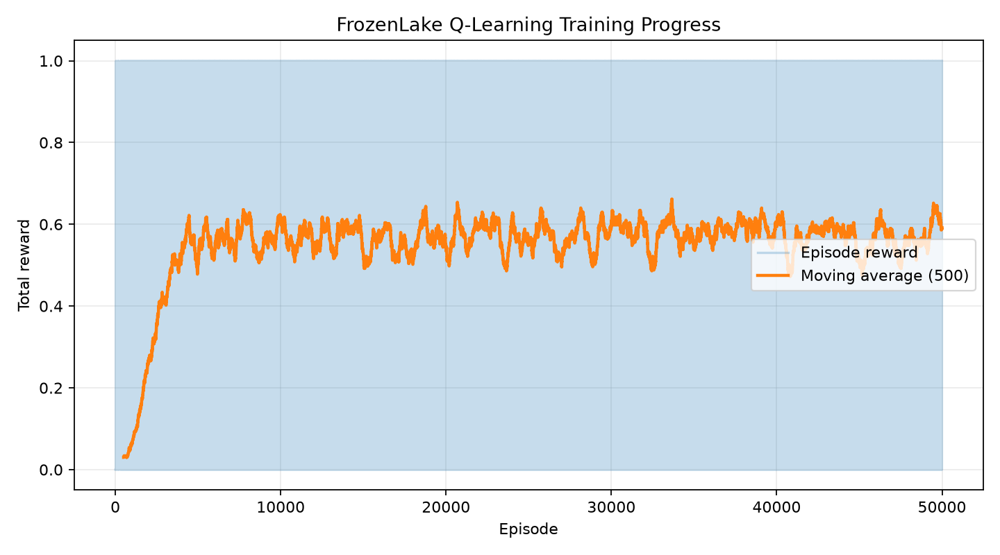

# Custom Reinforcement Learning Agent using FrozenLake-v1
**Course:** Topics in AI | **Assignment:** 1 / CLO-I  
**Student:** AYAN ALEEM | **Registration No.:** FA23-BAI-027

## 1. Problem Description
FrozenLake-v1 is a grid-world environment in which the agent starts at the initial tile and must reach the goal while avoiding holes. The state is the agent's current tile index (16 possible states on the standard 4×4 map). There are four actions: left, down, right, and up. The environment gives a reward of 1 for reaching the goal and 0 for other transitions. With `is_slippery=True`, movement is stochastic.

## 2. Methodology
Tabular Q-learning was implemented from scratch. The Q-table stores an estimated action value for each state-action pair. Epsilon-greedy action selection explores randomly with probability epsilon and otherwise selects the action with the largest Q-value.

The update rule is:

Q(s,a) ← Q(s,a) + α [r + γ maxₐ′ Q(s′,a′) − Q(s,a)]

For terminal transitions, the future-value term is treated as zero. Epsilon is gradually decayed to shift from exploration toward exploitation.

## 3. Experimental Setup and Hyperparameters
| Hyperparameter | Value |
|---|---:|
| Training episodes | 50,000 |
| Maximum steps per episode | 100 |
| Learning rate α | 0.1 |
| Discount factor γ | 0.99 |
| Initial ε | 1.0 |
| Minimum ε | 0.02 |
| ε decay | 0.9995 |
| Slippery dynamics | True |
## 4. Results and Discussion

Three experiments were conducted to investigate the effect of different hyperparameter settings on the Q-learning agent.

| Experiment | Learning Rate | Epsilon Decay | Success Rate | Average Episode Length |
|---|---:|---:|---:|---:|
| A | 0.1 | 0.9995 | 62% | 50.15 steps |
| B | 0.1 | 0.999 | 62% | 50.15 steps |
| C | 0.2 | 0.999 | 50% | 52.30 steps |

The training reward graph shows that the moving-average reward increases rapidly during the initial training phase and then fluctuates around approximately 0.55–0.60. This indicates that the agent learns a useful policy, but its performance does not improve consistently throughout training. Due to the stochastic nature of FrozenLake, the agent may still fail to reach the goal in some episodes.

Experiments A and B achieved the same evaluation success rate of 62%. Changing the epsilon decay did not improve the measured performance. Experiment C achieved a lower success rate of 50% after increasing the learning rate to 0.2. These results suggest that changing hyperparameters does not necessarily improve performance. Further testing with different random seeds and settings would be needed to draw stronger conclusions.

## 5. Conclusion

This project implemented a tabular Q-learning agent from scratch for the FrozenLake-v1 environment. The agent was trained for 50,000 episodes and evaluated over 100 episodes. The baseline experiment achieved a success rate of 62%. Hyperparameter experiments showed that the tested changes did not improve the measured performance. The project demonstrates the reinforcement learning workflow, including environment setup, agent training, evaluation, Q-table saving, reward visualization, and GIF generation.